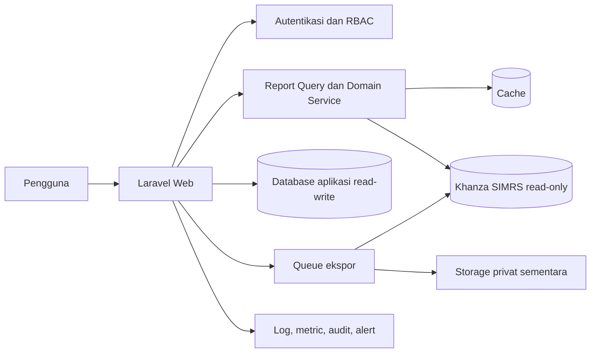

# Arsitektur Teknis

## Status Dokumen

Dokumen ini menerjemahkan PRD menjadi arah arsitektur dan keputusan awal. Bagian berlabel target belum menyatakan implementasi tersedia. Kondisi source tree aktual dicatat di `MEMORY.md` dan harus diverifikasi saat perubahan dibuat.

## Konteks Sistem

E-Eksekutif adalah aplikasi analitik dan pelaporan. Pengguna berinteraksi dengan Laravel untuk melihat KPI, tabel, chart, drill-down, serta ekspor. Laravel membaca data operasional dari Khanza SIMRS dan menyimpan state internal pada database aplikasi yang terpisah.

## Stack

### Terverifikasi Saat Bootstrap

- PHP 8.2 atau kompatibel sesuai constraint `^8.2`.
- Laravel 12.
- PHPUnit 11, Laravel Pint, Vite 6, dan Tailwind CSS 4.
- Koneksi `simrs` telah ditambahkan dan akses query aplikasi dibungkus service read-only.

### Target yang Memerlukan Keputusan/Implementasi

- Blade dengan UI server-driven; Livewire dan Alpine dapat dipilih setelah evaluasi kebutuhan interaksi.
- Chart.js untuk chart standar dengan tabel ekuivalen.
- Redis untuk cache, rate limit, session, dan queue bila infrastruktur mendukung.
- Horizon bila queue Redis dipakai.
- Library XLSX berbasis PhpSpreadsheet dan renderer PDF terpelihara.
- RBAC, audit, static analysis, dan monitoring melalui komponen yang dipilih serta dikunci versinya.

## Batas Komponen

- `routes` dan middleware menetapkan perimeter HTTP, autentikasi, izin, throttle, dan binding.
- Form Request memvalidasi tanggal, tahun, enum, pagination, sorting allowlist, dan scope filter.
- Controller/komponen UI hanya mengorkestrasi authorization, query, cache, dan response.
- Query Object mengenkapsulasi SQL setiap keluarga laporan serta selalu memilih koneksi `simrs` secara eksplisit.
- Domain Service mengenkapsulasi formula dan rule bisnis yang tidak tepat disimpan di SQL/view.
- DTO/View Model membatasi kolom dan tipe data yang keluar dari lapisan laporan.
- Policy/Gate mengotorisasi kemampuan dan scope data pada server.
- Export Job memakai filter ternormalisasi dan definisi laporan yang sama dengan UI.
- Blade hanya merender; SQL dan keputusan bisnis tidak diletakkan di view.

## Data dan Koneksi

### Database Aplikasi

Read-write untuk akun, role/permission, audit, setting, session/cache bila berbasis database, queue/failed job, metadata ekspor, dan state internal lain. Semua migration Laravel diarahkan ke koneksi ini.

### Database SIMRS

Read-only dan hanya menggunakan user database dengan privilege `SELECT` minimum. Larangan berlaku pada aplikasi, CLI, queue, test, migration, dan tool operasional. Nama schema historis dapat berupa `sik`, tetapi harus berasal dari konfigurasi environment dan tidak diasumsikan sama pada semua instalasi.

Defense in depth target:

- Akun database secara nyata tidak memiliki hak tulis/DDL.
- Koneksi bernama eksplisit dan tidak menjadi default untuk migration.
- Query object read-only, timeout terpisah, serta opsi TLS sesuai environment.
- Integration test menguji privilege dan memastikan operasi tulis gagal.
- Monitoring mendeteksi query lambat, kegagalan koneksi, dan pola tidak wajar.

## Strategi Laporan

- `ServiceVolumeReport`: laboratorium/radiologi dengan scope seluruh pasien/rawat jalan/rawat inap.
- `InventoryTransactionReport`: transaksi farmasi/nonmedis/dapur.
- `VendorMonthlyReport`: penerimaan vendor lintas domain inventori.
- `SupplierDebtReport`: hutang farmasi/nonmedis/dapur/inventaris.
- `TurnaroundTimeReport`: titik waktu mutu layanan.
- `RevenueReport`: akun bayar, closing, akun piutang, dan COA.

Setiap adapter memiliki mapping sumber dan test sendiri. Abstraksi hanya diterapkan setelah kesamaan stabil diketahui, bukan untuk memaksakan satu rule bagi domain berbeda.

## Query, Cache, dan Kinerja

- Bind seluruh nilai input; allowlist nama kolom sorting dan dimensi grouping.
- Gunakan rentang tanggal sargable dan hindari fungsi pada kolom terindeks di klausa `WHERE`.
- Hindari N+1 melalui conditional aggregation, subquery/CTE kompatibel, join teragregasi, atau batch query.
- Gunakan `EXPLAIN` dan dataset representatif sebelum menerima query prioritas.
- Pagination selalu server-side; rentang besar dialihkan ke queue atau ditolak dengan instruksi yang jelas.
- Cache key memuat nama laporan, filter kanonik, versi formula KPI, dan scope izin pengguna.
- Dashboard dapat memakai TTL singkat; laporan historis memakai TTL lebih lama berdasarkan freshness contract.
- Tampilkan timestamp data/cache agar pengguna memahami freshness.
- Retry hanya untuk operasi baca/job idempotent dan menggunakan backoff terbatas.

Target PRD: dashboard P95 <= 3 detik setelah cache hangat, laporan sinkron <= 5 detik untuk periode sampai 31 hari, dan ekspor besar <= 5 menit.

## Konsistensi dan Rekonsiliasi

Setiap KPI memiliki ID/versi, formula, owner, tabel/kolom sumber, join, pengecualian, timezone, aturan null/tanggal nol, pembulatan, freshness, dan data classification. Perubahan formula memerlukan persetujuan owner bisnis.

Harness rekonsiliasi merekam laporan, periode/filter, baseline legacy, hasil baru, selisih, versi formula, klasifikasi perbedaan, reviewer, dan keputusan. Dataset tidak boleh memaparkan data pasien di repository.

## Keamanan Teknis

- Autentikasi modern dengan hashing adaptif; jangan migrasikan password reversible legacy.
- Session dirotasi setelah login; cookie aman; logout POST ber-CSRF; login di-rate-limit.
- Permission granular diterapkan pada route, query scope, drill-down, dan ekspor.
- Blade escaping tetap aktif; raw HTML dan CSP exception memerlukan review.
- Ekspor disimpan privat, diotorisasi saat pembuatan dan pengunduhan, diaudit, dinetralisasi dari formula injection, serta kedaluwarsa.
- Log aplikasi dipisahkan dari audit event. Keduanya meminimalkan data pasien dan tidak menyimpan secret.
- Error production menggunakan correlation ID dan pesan aman tanpa SQL/stack trace.

Rincian tata kelola berada di `SECURITY.md`.

## Strategi Pengujian

- Unit test untuk formula, normalisasi, klasifikasi, pembulatan, dan adapter.
- Feature test untuk auth, authorization, filter, pagination, audit, ekspor, serta response gagal/empty.
- Integration test menggunakan fixture schema Khanza disposable dan koneksi aplikasi disposable.
- Contract test untuk variasi schema yang didukung.
- Rekonsiliasi terhadap legacy dan UAT owner domain.
- Load test, accessibility test, dependency scan, SAST, dan DAST sesuai risiko.

Production SIMRS tidak boleh dipakai sebagai target test otomatis.

## Observability dan Operasi

- Structured log dengan timestamp, environment, service, severity, event, correlation ID, dan identifier ter-pseudonim bila diperlukan.
- Metrics minimum: latency, request/error rate, query latency, pool saturation, cache hit, queue depth/age, failed job, export duration, dan storage capacity.
- Audit minimum: login/logout, login gagal, perubahan akun/role/permission, akses/ekspor sensitif, perubahan setting, dan tindakan administrator.
- Alert harus mempunyai owner, severity, runbook, threshold, dan prosedur eskalasi.

## Catatan Keputusan Arsitektur

### ADR-001 - Dua Database dengan Batas Kepercayaan Terpisah

- Status: diterima sebagai baseline PRD.
- Keputusan: state aplikasi berada pada database aplikasi; SIMRS hanya dibaca melalui koneksi khusus.
- Alasan: mengurangi risiko integritas operasional dan memungkinkan evolusi aplikasi tanpa mengubah schema Khanza.
- Konsekuensi: deployment, test, health check, backup, dan observability harus memahami dua koneksi.

### ADR-002 - SIMRS Read-only Secara Teknis dan Prosedural

- Status: diterima.
- Keputusan: gunakan privilege database `SELECT` saja ditambah guardrail aplikasi dan CI.
- Alasan: larangan pada kode saja tidak cukup sebagai kontrol keamanan.
- Konsekuensi: kebutuhan indeks/view harus melalui DBA dan change management di luar migration aplikasi.

### ADR-003 - Query Object dan Domain Service

- Status: diterima.
- Keputusan: pisahkan akses data laporan dari HTTP/view dan pisahkan formula lintas tabel ke service.
- Alasan: meningkatkan testability, reuse, rekonsiliasi, dan review SQL.
- Konsekuensi: setiap laporan memerlukan kontrak input/output dan test yang eksplisit.

### ADR-004 - UI Server-driven sebagai Default

- Status: diusulkan, konsisten dengan PRD.
- Keputusan: prioritaskan Blade dan interaksi server-driven daripada SPA penuh.
- Alasan: dominasi tabel/filter/report tidak memerlukan kompleksitas state client besar.
- Konsekuensi: pilihan Livewire/Alpine tetap harus dibuktikan melalui vertical slice sebelum menjadi standar final.

### ADR-005 - Ekspor Besar Asinkron

- Status: diterima sebagai kebutuhan produk.
- Keputusan: ekspor besar berjalan sebagai job dan menghasilkan artifact privat berumur terbatas.
- Alasan: melindungi latency request dan database dari pekerjaan panjang.
- Konsekuensi: dibutuhkan queue, idempotency, monitoring, notification, authorization unduh, expiry, dan housekeeping.

### ADR-006 - Versi Definisi KPI dalam Cache dan Rekonsiliasi

- Status: diterima.
- Keputusan: formula KPI memiliki versi yang menjadi bagian cache key dan bukti rekonsiliasi.
- Alasan: mencegah hasil lama dipakai setelah perubahan formula dan menjaga auditabilitas angka.
- Konsekuensi: perubahan bisnis wajib memperbarui versi dan dokumentasi KPI.
